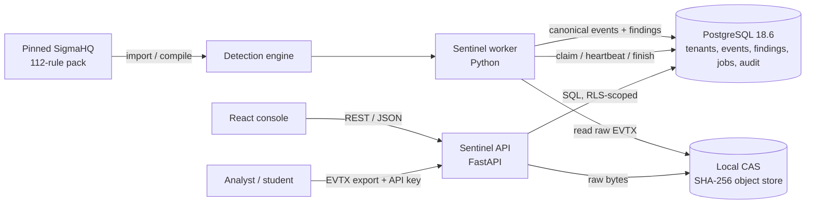
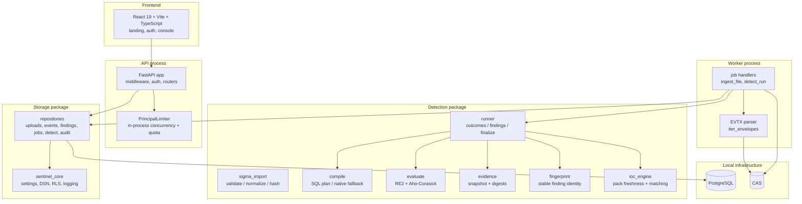
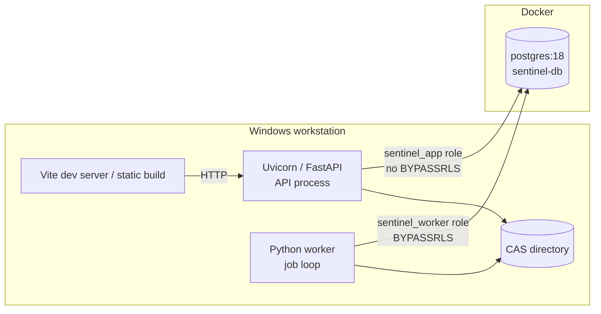
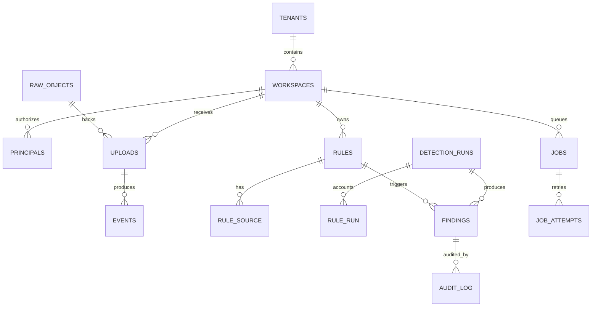
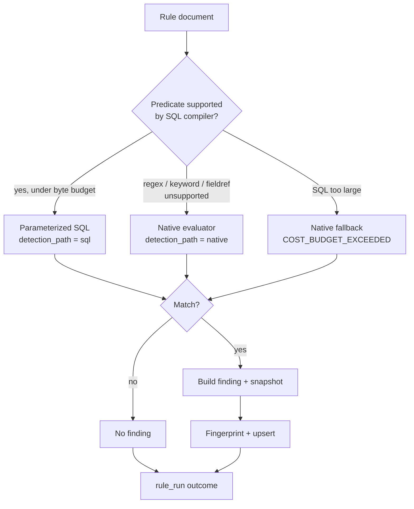
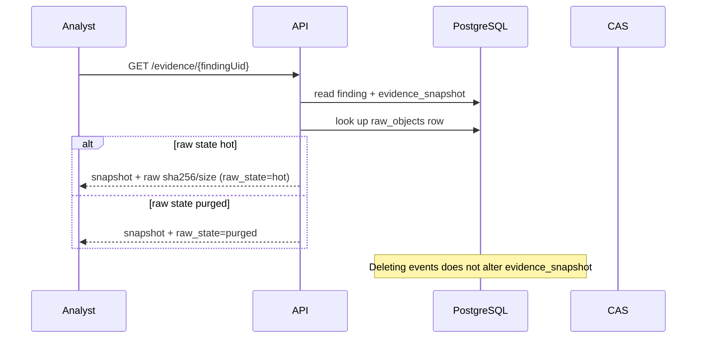

# SENTINEL — Architecture and Data Flow

**Status:** Implementation-grounded architecture notes for poster figures and text  
**Prepared:** 2026-10-23  
**Scope:** Verified M2 vertical slice; M3 routes/engines are present in the working tree but are not fully committed or complete.  
**Evidence base:** `docs/poster-research/SENTINEL_RESULTS_AND_EVIDENCE.md`

---

## 1. Scope and reading guide

This document describes the architecture that is visible in the repository today. It distinguishes:

- **Implemented and tested:** EVTX ingest, CAS storage, canonical events, rule pack import, detection runs, findings/evidence, RLS, job queue, core read APIs, console pages.
- **Implemented but partially verified or uncommitted:** M3 IOC-pack routes and engine, rule import/read routes, extractor scaffolding, frontend console.
- **Declared but not implemented, or incomplete:** collection-level workspace routes, several OpenAPI mutations/list endpoints, multi-format ingestion, production auth/TLS.

Do not turn the “declared” layer into a poster claim. The poster should present the M2 slice as the verified system and M3 as in progress.

---

## 2. Design principles

1. **Evidence before convenience.** A finding must remain inspectable after raw logs are purged.
2. **Two planes, one database.** The API handles control and reads; the worker handles long-running ingest/detection; PostgreSQL is the shared source of truth.
3. **Deterministic, explicit detection.** Rules execute through one of two paths, and every fallback is recorded as a reason code.
4. **Tenant isolation at the database.** RLS is the backstop, not just an application filter.
5. **Fail visibly.** Partial rule outcomes, warnings, job attempts, dead letters, and run statuses are stored rather than hidden.
6. **Pinned content.** The shipping rule pack is identified by upstream commit and SHA-256.
7. **Bounded scope.** Batch EVTX, single node, no blocking. The architecture does not pretend to be a distributed SIEM.

---

## 3. System context



**Trust boundary:** the uploaded EVTX is untrusted input. The API and worker are trusted application code. The database and CAS are local infrastructure. There is no external identity provider, message broker, or object-store service in the verified slice.

---

## 4. Container and module view



### Module responsibilities

| Module | Responsibility |
|---|---|
| `sentinel_core` | Settings, config precedence, DSN selection, DB transactions, RLS session variables, structured logging |
| `sentinel_storage` | SQL repositories for tenants, uploads, events, findings, rules, detection runs, jobs, audit |
| `sentinel_ingest` | Upload gate, CAS adapter, EVTX parsing, job handlers |
| `sentinel_detect` | Sigma import, compile/plan, native evaluation, run orchestration, evidence, fingerprints, IOC matching |
| `apps/api` | FastAPI app, middleware, auth stub, routers, metrics |
| `web` | React console and public landing/auth pages |

---

## 5. Deployment view (verified local topology)



- Database image: PostgreSQL **18.6**.
- Roles: `sentinel_app` (API; RLS enforced), `sentinel_migrator` (schema owner), `sentinel_worker` (job processor; `BYPASSRLS`).
- CAS: local filesystem, keyed by SHA-256.
- No reverse proxy, TLS terminator, Redis, Celery, Kafka, or cloud object store in the verified slice.
- The local compose port was remapped in this environment; do not put host ports on the poster.

---

## 6. Data model

### 6.1 Table groups

| Group | Base tables | Purpose |
|---|---|---|
| Identity | `tenants`, `workspaces`, `principals` | Tenant/workspace scope and API principals |
| Artifacts | `raw_objects`, `uploads` | SHA-256 CAS objects and upload/triage metadata |
| Events | `events` (+ 3 monthly partitions) | Canonical `canonical-event/v1` documents |
| Rule content | `rules`, `rule_source`, `rule_baseline` (+ 2 partitions), `fim_baseline` | Rule documents, verbatim source, baselines |
| IOC content | `ioc_pack`, `ioc_entry` | Signed IOC pack metadata and indicators |
| Work | `jobs`, `job_attempts`, `detection_runs`, `rule_run` | Queue, retries, run accounting |
| Findings | `findings` (+ 3 monthly + 1 default partition) | Alerts and frozen evidence JSONB |
| Support | `artifact_facts`, `idempotency_keys`, `audit_log` (+ 3 partitions), `retention_policies` | Derived facts, idempotency, audit, retention |

Counts in current DDL:

- **21 base tables**
- **12 partition children**
- **33 policies**
- **33 RLS-enabled relations**

The `schema.sql` header and `research/DEVIATION_REGISTER.md` M0-A1 still say 32 policies / 11 partitions. That prose is stale; the contract test and current DDL say 33/12. If the poster needs one number, use “33 policies across 21 base tables and 12 partition children,” or omit the count.

### 6.2 Entity relationships (simplified)



This is a logical view; actual foreign keys and partition routing are defined in `schema.sql`. `findings.evidence_snapshot` intentionally does **not** foreign-key the raw object or the event rows; it stores digests and pointers so evidence survives retention.

### 6.3 Evidence snapshot shape

```json
{
  "schema_version": "sentinel-evidence/v1",
  "finding": {
    "schema_version": "sentinel-finding/v1",
    "rule_id": "...",
    "rule_name": "...",
    "kind": "alert",
    "severity": "HIGH",
    "time": "2017-12-26T...",
    "event_ids": ["..."],
    "host": {"agent_id": null, "instance_id": null, "name": "DESKTOP-2KGM189"},
    "user": {"name": "SYSTEM", "domain": null},
    "detection_path": "sql",
    "reason_codes": [],
    "payload_excerpt": {"image": "C:\\Windows\\system32\\whoami.exe"},
    "attck_refs": ["T1033"],
    "falsepositives_note": null,
    "fingerprint": "..."
  },
  "rule": {
    "rule_id": "...",
    "name": "...",
    "title": "...",
    "source_ref": "...",
    "source_spec": "2.1.0",
    "status": "stable",
    "level": "high",
    "document_sha256": "...",
    "source_sha256": "..."
  },
  "run": {
    "run_id": "...",
    "config_hash": "..."
  },
  "events": [
    {"event_uid": "...", "sha256": "..."}
  ]
}
```

Notes:

- The snapshot contains the **finding**, **rule provenance**, **run identity**, and **event digests**.
- It deliberately does not contain raw bytes; that is why purge does not destroy it.
- `rule_document_sha256` and event digests can change when provenance metadata changes (for example, import timestamps), so the M2 test recomputes them rather than pinning unstable values.
- The snapshot is frozen by application code. There is no database trigger blocking an owner/superuser from rewriting it. Do not call it cryptographically tamper-proof.

---

## 7. Ingestion flow

### 7.1 Upload API

1. Client sends `POST /v1/workspaces/{workspaceId}/uploads` with a multipart EVTX and API key.
2. The API authenticates the key and checks the principal’s workspace binding.
3. Request-level and file-level gates enforce size, field, concurrency, hourly quota, and workspace storage quota.
4. The API computes SHA-256/SHA-1/MD5, checks the CAS for an existing object, and writes the raw bytes if new.
5. It inserts a `raw_objects` row and an `uploads` row, then enqueues an `ingest_file` job with idempotency key `ingest:{artifact_id}`.
6. It writes an `upload.accept` audit event and returns `202 Accepted`.
7. Rejections before persistence return `4xx` and are audited as `upload.reject` (denied); the upload row does not exist.

**Important gap:** `uploads.triage_status` has schema values `failed` and `rejected_by_policy`, but the worker writes only `running` and `done`. Rejected pre-persistence uploads are deleted (204) rather than stored with a rejection state. A crashed ingest can leave `running` while the job dead-letters. Do not claim complete triage-state lifecycle.

### 7.2 Worker ingest

```mermaid
sequenceDiagram
    participant API as API
    participant DB as PostgreSQL
    participant W as Worker
    participant CAS as CAS

    API->>CAS: put raw EVTX (SHA-256)
    API->>DB: insert raw_objects, uploads; enqueue ingest_file
    API-->>W: job available
    W->>DB: claim job (FOR UPDATE SKIP LOCKED)
    W->>DB: set upload triage_state = running
    W->>CAS: read raw EVTX
    loop batches of 500
        W->>W: iter_envelopes -> canonical JSON
        W->>DB: bulk insert events
    end
    W->>DB: set triage_state = done
    W->>DB: create detection_run + enqueue detect_run
    W->>DB: finish job + job_attempt
```

Details:

- `iter_envelopes()` is called unconditionally. Only EVTX is actually parsed. A non-EVTX upload fails in the parser; the API’s format chips are broader than the implementation.
- Events are batched at **500** rows per insert.
- Parse statistics include total records, mapped events, unmapped EventIDs, parse errors, and tail errors.
- If zero events map, the job summary includes `NO_EVENTS_MAPPED`.
- On successful ingest, the worker auto-creates a `detection_run` scoped to `harvest_run_id` plus `artifact_id`, then enqueues `detect_run` with idempotency key `detect:{run_id}`.
- The worker uses `sentinel_worker` (`BYPASSRLS`) but still sets tenant/workspace GUCs for defense in depth.

### 7.3 Job queue semantics

- Claim: `SELECT ... FOR UPDATE SKIP LOCKED`, priority ascending, then `run_after`.
- Lease: `locked_by`, `locked_at`, `heartbeat_at`.
- Retry: full-jitter exponential backoff; attempts recorded in `job_attempts`.
- Reaper: expired leases become `lost_lock`; job requeues or dead-letters after `max_attempts`.
- Idempotency: unique `(tenant_id, workspace_id, idempotency_key)`.
- Statuses: `queued`, `running`, `succeeded`, `failed`, `dead`, `cancelled`.

This gives at-least-once execution, not exactly-once side effects. Ingest is made retry-tolerant by idempotency and event identity; detection finalization is designed to be retry-idempotent for findings.

---

## 8. Detection flow

### 8.1 Rule import and normalization

- A rule pack is validated, normalized, and stored in `rules` with:
  - stable `rule_id`;
  - source (`sigma`, `native`, etc.);
  - source ID and verbatim `rule_source.text`;
  - source SHA-256;
  - normalized document and `schema_tag`;
  - severity/level mapping and ATT&CK references.
- The shipped pack is `sigmahq-windows-process-creation`, 112 rules, SigmaHQ commit `8a48134…`, pack SHA-256 `3e2853f4…`.
- The default demo workspace has 113 enabled rules because it also contains `Demo - Suspicious Whoami Execution`.

### 8.2 Execution planning



Reason codes that may be attached to a rule or finding:

| Code | Meaning |
|---|---|
| `UNMAPPED_FIELD` | Rule references a field not present in the canonical schema |
| `REGEX_NATIVE_ONLY` | Predicate requires regex; native path |
| `KEYWORD_NATIVE_ONLY` | Large keyword set; native path |
| `FIELDREF_NATIVE_ONLY` | Field reference not safely compilable; native path |
| `COST_BUDGET_EXCEEDED` | Compiled SQL exceeds the byte budget; native fallback |
| `BASELINE_MISSING` | Baseline-dependent rule has no baseline for this window |
| `UNSUPPORTED_RULE_KIND` | Rule kind is not executable by this engine |
| `IOC_PACK_MISSING` | Rule references an absent/inactive IOC pack |
| `IOC_PACK_STALE` | Pack is older than the freshness gate or digest drift |

These are **visible warnings**, not silent skips. A rule can still execute partially and emit findings; its `rule_run` outcome becomes `ok_partial`.

### 8.3 Run accounting

- `detection_runs` carries scope, status, config hash, timestamps, and a JSON summary.
- `rule_run` carries per-rule outcome, finding count, processed events, detection path, reason codes, and error.
- Terminal statuses: `completed`, `completed_with_warnings`, `failed`, `cancelled`.
- The demo run had 96 `ok`, 17 `ok_partial`, 99 SQL paths, 14 native paths, 2 findings, and `completed_with_warnings`.

### 8.4 Finding identity and deduplication

The fingerprint tuple includes:

- tenant ID;
- workspace ID;
- rule ID;
- event UTC time;
- sorted event UIDs;
- host hostname;
- user name.

It deliberately excludes `run_id`, detection path, wall clock at write time, and finding UID. This is what makes cross-path conformance meaningful and `finalize()` retry-idempotent.

**Dedup caveat:** the fingerprint excludes run ID, but the unique index is `(tenant_id, workspace_id, rule_id, fingerprint, time_utc)`. Suppression is run-scoped; a second run over the same events can emit another row. Do not claim global deduplication.

---

## 9. Evidence and retention flow



Verified drill:

1. Read evidence while raw object is hot.
2. Mark `raw_objects.state = purged` and set `purged_at`.
3. Delete the backing `events` rows.
4. Re-read evidence: the snapshot is byte-identical and structurally complete.

What this proves:

- The finding is not a pointer into mutable raw logs.
- Event digests and rule source hashes survive retention.

What this does **not** prove:

- The database owner cannot rewrite the snapshot.
- The audit log is cryptographically tamper-evident.
- The CAS is replicated or backed up.
- The evidence is legally admissible.

---

## 10. Multi-tenancy and access control

### 10.1 RLS model

- Tenant/workspace context is set per transaction with `set_config('sentinel.tenant_id', ...)` and `set_config('sentinel.workspace_id', ...)`.
- API uses `sentinel_app` (no `BYPASSRLS`).
- Worker uses `sentinel_worker` (`BYPASSRLS`) for cross-tenant claim, but handlers still set GUCs.
- Policies exist on tenant-scoped base tables and every partition child.
- `raw_objects` has no tenant column; its `raw_objects_cas` pass-through policy is documented, and scoping is through the `uploads` join in application code.
- `tenants_ws` scopes only on tenant ID because a tenant row is the tenant.

### 10.2 Authentication and authorization

- Static API keys from configuration are compared with `hmac.compare_digest`.
- Keys are hashed with unsalted SHA-256 for the database `principals` bootstrap; argon2 is a declared dependency but unused.
- Authentication is mandatory in `authenticate()`; there is no “no key means dev” bypass in the current function. Some older descriptions of a `None` principal are stale or refer to a different path. Verify before claiming dev bypass.
- Workspace binding is checked on every route (`principal.workspace_id == workspaceId`); mutating mismatches are audited as denied.
- Stored `scopes` are not a complete RBAC layer: routes primarily enforce workspace binding, not per-action scope checks. Do not claim fine-grained RBAC.
- No TLS, no token expiry, no key rotation, no external IdP.

### 10.3 API surface

`openapi.yaml` declares **23 paths / 36 operations**. Path-level `parameters` entries are not operations; parser counts that include them are wrong.

Implemented routers cover health/readiness/metrics, uploads/events, findings/evidence, rules read/import, runs, jobs retry, IOC packs, and audit. The contract is ahead of the app in places. In particular, collection-level workspace routes (`GET`/`POST /v1/workspaces`) are declared but not routed; the console’s workspaces page acknowledges this. Treat `openapi.yaml` as the intended contract, and verify a route before claiming it works.

Cursor pagination is real for events; other list endpoints return `"next": null`. Do not claim cursor pagination across the API.

---

## 11. Frontend architecture

- React 19 + Vite + TypeScript + Tailwind.
- Public pages: landing, login, logout, forgot-password, not-found.
- Console child routes: overview, workspaces, uploads, upload detail, events, findings, finding detail, evidence, rules, runs, run detail, jobs, IOC packs, audit, system.
- `ConsoleLayout` provides navigation and workspace context.
- The landing page clearly labels its sample data as a “Demonstration — committed test fixture — not live product output.”
- The console is not fully backend-complete: `WorkspacesPage` explicitly notes that `GET /v1/workspaces` is not routed; list pages handle `next: null`.
- No Playwright, Cypress, or Selenium tests were found. There is no automated UI test claim.

**Demo screenshot rule:** if the poster shows a console screenshot, capture it from the local app in demo mode, record the date and run ID, and label it “demo fixture.” Do not use the landing-page illustration as if it were live output.

---

## 12. Failure modes and observability

| Failure | Current behavior | Poster-safe wording |
|---|---|---|
| Invalid/unsupported file type | Parser error; job fails; upload may remain `running` | “EVTX-only; failures are visible in job/run state, but triage-state lifecycle is incomplete” |
| Zero mapped events | Job summary `NO_EVENTS_MAPPED`; detection may still run | “Empty/unmapped ingests are reported” |
| Rule field missing | `UNMAPPED_FIELD`; outcome may be `ok_partial` | “Partial rules are accounted, not silently dropped” |
| SQL too large | Native fallback with `COST_BUDGET_EXCEEDED` | “Cost fallback is explicit” |
| Baseline absent | `BASELINE_MISSING` | “Cold-start behavior is visible” |
| Worker crash | Lease expires; reaper requeues; attempt recorded | “At-least-once job execution with dead-lettering” |
| API/worker restart | Jobs persist in PostgreSQL; CAS persists on disk | “Restartable local deployment” |
| DB unavailable | Readiness fails; requests error | “No HA; single database” |
| IOC pack stale | `IOC_PACK_STALE`; low-severity findings suppressed | “Freshness gate is enforced” |

Observability:

- Structured logs via `structlog`/`python-json-logger`.
- Prometheus metrics endpoint (`/metrics`) with HTTP and upload counters.
- `/health`, `/ready`.
- Audit log for upload/rule/IOC/triage actions.
- No distributed tracing backend; OpenTelemetry dependencies exist but are not a complete tracing deployment.

---

## 13. Security boundaries and non-claims

### Boundaries

1. **Browser -> API:** untrusted network in principle; no TLS in the app.
2. **API -> PostgreSQL:** trusted local network; RLS enforced for app role.
3. **Worker -> PostgreSQL:** trusted platform processor with `BYPASSRLS`.
4. **Worker -> CAS:** local filesystem path from `storage_uri`; path traversal defenses must be verified before exposure.
5. **EVTX parser -> worker:** untrusted file content parsed in-process; size limits reduce but do not eliminate parser risk.

### Non-claims

- No endpoint agent, live monitoring, or network monitoring.
- No blocking, quarantine, removal, or remediation.
- No malware execution/detonation.
- No production identity, TLS, HA, backup, or disaster recovery.
- No “immutable” audit log enforced by the database.
- No global deduplication.
- No multi-format ingestion.
- No ML/AI detection.

---

## 14. Why the M2 slice is the right poster scope

The six M2 exit gates cover the claims that matter:

1. Planted EVTX -> expected finding with correct path/fingerprint.
2. Evidence survives raw-object purge and event deletion.
3. Timeline p95 under 2 s for 100k events + 1k findings.
4. Cold-start reason codes appear when baselines are absent.
5. Conformance oracle has zero unexplained divergences.
6. UNSW-NB15 parses with zero drops and reports F1/per-category recall.

M3 adds IOC packs, rule workbench routes, and extractor scaffolding, but the working tree is uncommitted and the IOC test is time-sensitive. Presenting M2 as the verified core and M3 as “in progress” is more credible than claiming the full roadmap shipped.

---

## 15. Source map for figure verification

| Figure element | Source |
|---|---|
| API/worker split | `apps/api/sentinel_api/app.py`, `packages/ingest/sentinel_ingest/worker_handlers.py` |
| CAS | `packages/ingest/sentinel_ingest/store.py`, `schema.sql` `raw_objects` |
| Canonical event shape | `packages/ingest/sentinel_ingest/evtx_parser.py`, `canonical-event/v1` schema |
| Rule import/compile | `packages/detect/sentinel_detect/sigma_import.py`, `compile.py` |
| Native evaluation | `packages/detect/sentinel_detect/evaluate.py` |
| Run orchestration | `packages/detect/sentinel_detect/runner.py` |
| Evidence snapshot | `packages/detect/sentinel_detect/evidence.py` |
| Fingerprint | `packages/detect/sentinel_detect/fingerprint.py` |
| Job queue | `packages/storage/sentinel_storage/repos_jobs.py`, `schema.sql` `jobs` |
| RLS | `schema.sql`, `packages/core/.../rls.py`, `tests/contract/test_rls_lint.py` |
| API surface | `openapi.yaml`, `apps/api/sentinel_api/routes_*.py` |
| Frontend routes | `web/src/App.tsx`, `web/src/console/*` |
| M2 gates | `research/M2_EXIT_AUDIT.md`, `tests/integration/test_m2_exit.py` |
| Schema counts | `schema.sql`, `tests/contract/test_rls_lint.py` |

---

## 16. Architecture summary for the poster

> Sentinel is a two-plane, single-node HIDS backend. The API accepts EVTX and serves reads; the worker leases jobs, parses events, and runs detection. PostgreSQL holds canonical events, rule content, job state, findings, and RLS policies; a local CAS holds raw bytes by SHA-256. Findings freeze rule provenance, run identity, and per-event digests before retention can delete the source. The verified M2 slice is deliberately batch-oriented and EVTX-only; M3 IOC/rule-workbench work is in progress.
