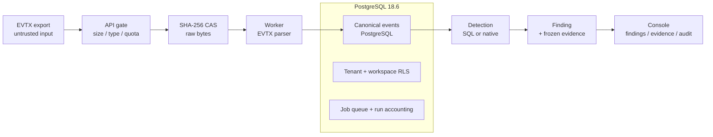
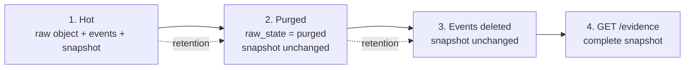

# SENTINEL — Poster Visuals and Layout Specification

**Status:** Production specification; assets not yet created  
**Prepared:** 2026-10-23  
**Target:** A0 portrait (841 x 1189 mm) by default; scale proportionally for A1/A2. Confirm venue size before printing.  
**Evidence base:** `docs/poster-research/SENTINEL_RESULTS_AND_EVIDENCE.md` and `SENTINEL_ARCHITECTURE.md`

---

## 1. Visual thesis

The poster should feel like a **forensic system diagram**, not a marketing landing page.

Three visual ideas, in order:

1. **Chain of custody:** raw artifact -> canonical event -> finding -> frozen evidence.
2. **Two execution paths:** SQL and native, with an explicit agreement/exception record.
3. **Honest boundary:** a visible “what this is not” band.

Avoid: glowing shields, hooded figures, fake dashboards, stock “cyber” imagery, matrix rain, and unlabeled screenshots.

---

## 2. Canvas and grid

### A0 portrait baseline

| Property | Value |
|---|---|
| Trim size | 841 x 1189 mm |
| Safe margin | 30 mm all sides |
| Header band | 220 mm tall |
| Footer band | 70 mm tall |
| Content area | 781 x 869 mm |
| Columns | 3 equal columns, 18 mm gutters |
| Column width | ~248 mm |
| Baseline grid | 8 mm |
| Bleed | 3 mm if printer requires |

### Reading path

Use a **Z + column** path:

1. Title and one-line claim (top).
2. Key result strip (under header).
3. Left column: problem, questions, contributions, system context.
4. Middle column: pipeline, detection semantics, evidence.
5. Right column: evaluation, results, limits, future, references.
6. Footer: QR, contact, license, date.

If the poster is landscape, keep the same three-column order but move the key result strip to the right edge.

---

## 3. Header

### Content

```text
SENTINEL
An Evidence-First Lightweight HIDS for Windows Telemetry

[Author Name(s)] · [Department, Institution]
[Supervisor, if applicable] · [Venue, Date]

One-line claim:
EVTX in. Verifiable findings out. Evidence that outlives the logs.
```

### Specification

- Title: 150-170 pt, heavy weight, white on deep navy.
- Subtitle: 54-60 pt, cyan accent.
- Author block: 30-34 pt.
- One-line claim: 36-40 pt, amber accent, maximum 12 words.
- Logo: only if the author supplies an official institution/project logo. Do not invent one.
- QR: 55 x 55 mm, bottom-right of header or footer. Verify it scans to the intended destination.

### Key result strip

Place four compact tiles directly below the header. Each tile: one big number, one short label, one qualifier line.

| Tile | Big number | Label | Qualifier |
|---|---:|---|---|
| 1 | **6/6** | M2 exit gates | Historical audit; 539 tests then |
| 2 | **0** | unexplained conformance divergences | 23 rules; 19 comparable; 4 native-only |
| 3 | **1.41 s** | timeline p95 | 101k rows; 2 s local budget |
| 4 | **0.886** | UNSW-NB15 test F1 | 6-rule research pack; not shipping pack |

Do not use “88.6% detection” as the big label. The qualifier is mandatory.

---

## 4. Color and typography

### Palette

| Token | Hex | Use |
|---|---|---|
| Ink | `#0B1220` | Background, header |
| Panel | `#111C2E` | Figure panels |
| Panel alt | `#16243A` | Alternate rows/cards |
| Text | `#E5EDF7` | Body text on dark |
| Muted | `#9FB0C7` | Captions, qualifiers |
| Cyan | `#22D3EE` | Primary accent, SQL path, links |
| Amber | `#F59E0B` | Warnings, caveats, highlights |
| Green | `#34D399` | Pass / verified |
| Red | `#F87171` | Limits / failures |
| White | `#FFFFFF` | Title |

Rules:

- Maximum three accent colors in one figure.
- Do not rely on color alone: pair green/red with icons, labels, or patterns.
- Body text contrast must be at least 7:1 against the panel.
- Avoid pure black text on pure white for large areas; use off-white panels.

### Typography

| Element | A0 size | Notes |
|---|---:|---|
| Title | 150-170 pt | Tight leading, no all-caps subtitle |
| Section heading | 44-48 pt | Numbered or icon-led |
| Subheading | 32-34 pt | Sentence case |
| Body | 24-27 pt | 1.25-1.35 line height |
| Bullet | 24-26 pt | Maximum 2 lines each |
| Caption | 18-20 pt | Muted color |
| Footnote | 15-17 pt | References, disclaimers |

Font choice: a humanist sans with tabular figures for numbers (Inter, Source Sans 3, IBM Plex Sans, or the institution’s brand font). Use a monospace face only for code, hashes, and file paths.

---

## 5. Figure plan

Six figures maximum. If space is tight, drop F6 first, then F4b.

| ID | Figure | Purpose | Size |
|---|---|---|---|
| F1 | System context / pipeline | Show the end-to-end flow in one glance | Full width, 170 mm tall |
| F2 | Evidence lifecycle | Show why evidence survives purge | Half width, 150 mm tall |
| F3 | Detection path decision | Show SQL vs native and reason codes | Half width, 150 mm tall |
| F4 | Results dashboard | Put the four evaluation lenses together | Full width, 220 mm tall |
| F5 | Demo evidence panel | Show a real finding/evidence view | Half width, 160 mm tall |
| F6 | Trust boundary / limits | Make non-claims visible | Full width, 80 mm tall |

---

## 6. F1 — System context and pipeline

### Layout

Horizontal, left-to-right, five stages:

```text
[EVTX export] -> [API + CAS] -> [Canonical events] -> [Detection] -> [Finding + evidence]
```

Under the stages, add a thin band:

```text
PostgreSQL 18.6  |  tenant/workspace RLS  |  job queue  |  React console
```

### Visual style

- Stages as rounded rectangles, 4 mm radius.
- Raw artifact icon: document with SHA-256 tag.
- CAS icon: stacked cylinders labeled “SHA-256 CAS.”
- Event icon: JSON braces.
- Detection icon: split path (SQL / native).
- Finding icon: shield with a document, not a generic warning triangle.
- Use arrows with short labels: `hash + store`, `parse`, `evaluate`, `freeze`.
- Include one small lock icon on the RLS band.

### Simplified Mermaid source



### Caption

> **Figure 1. Evidence-preserving pipeline.** Raw EVTX is gated, hashed into a content-addressed store, parsed into canonical events, evaluated by a pinned rule pack, and frozen into a finding with rule/event digests before retention can remove the source.

---

## 7. F2 — Evidence lifecycle

### Layout

Four horizontal panels:

1. **Raw hot:** artifact + event rows + snapshot.
2. **Raw purged:** artifact marked purged; snapshot unchanged.
3. **Events deleted:** event rows gone; snapshot unchanged.
4. **Evidence read:** snapshot still returns complete.

Use a persistent “snapshot” card that stays visually identical across panels, while the raw/event cards fade or get a red strike-through.

### Mermaid source



### Key callout

> “The snapshot stores what the finding claimed, not a pointer to bytes that can disappear.”

### Caption

> **Figure 2. Evidence outlives retention.** The M2 drill purges the raw object, then deletes the backing event rows. The evidence snapshot remains byte-identical because it contains rule provenance, run identity, and per-event digests rather than raw bytes.

### Accuracy guard

Do not write “immutable” without the qualifier. Use “frozen by application code” or “structurally complete after purge.” A database owner can still rewrite JSONB; the poster must not imply cryptographic immutability.

---

## 8. F3 — Detection path decision

### Layout

A single decision tree, top-to-bottom:

```text
Rule
 |
 +-- supported predicate + under SQL byte budget? -- yes --> SQL plan
 |
 +-- regex / keyword / fieldref / over budget? ----- yes --> Native evaluator
 |
 +-- unsupported kind? ---------------------------- yes --> UNSUPPORTED_RULE_KIND
 |
 +-- baseline missing? ----------------------------- yes --> BASELINE_MISSING
 |
 +-- IOC pack missing/stale? ----------------------- yes --> IOC_PACK_MISSING / STALE
 |
 +--------------------------------------------------------> rule_run outcome
```

### Visual style

- SQL branch: cyan.
- Native branch: amber.
- Warning codes: small monospace chips.
- Add a footer note: “Warnings are stored, not logged away.”

### Caption

> **Figure 3. Two paths, explicit exceptions.** Simple predicates compile to parameterized SQL. Regex, keyword-heavy, or unmapped-field rules use the native evaluator. Every fallback carries a reason code; partial rules produce `ok_partial` rather than disappearing.

### Data callout

> Demo run: **99 SQL / 14 native**, **96 ok / 17 ok_partial**, 2 findings, `completed_with_warnings`.

---

## 9. F4 — Results dashboard

### 9.1 Panel A: conformance

Donut or stacked bar:

- 19 comparable rules (green).
- 4 native-only rules (amber).
- 0 unexplained divergences (center label, large).

Label: “23-rule corpus · 0 unexplained divergences.”

Do not draw a 100% “pass” ring without the 4 native-only segment; that would hide the exclusions.

### 9.2 Panel B: timeline

Horizontal gauge:

- 0 to 2,000 ms scale.
- Marker at 1,413 ms.
- Budget line at 2,000 ms.
- Label: “p95 1.41 s · 101k rows · 5 samples.”

Add “local single-node” in 18 pt muted text.

### 9.3 Panel C: UNSW-NB15

Grouped bars for train and test:

| Metric | Train | Test |
|---|---:|---:|
| Precision | 0.954 | 0.838 |
| Recall | 0.885 | 0.939 |
| F1 | 0.918 | 0.886 |
| FPR | 0.092 | 0.223 |

Use train as muted gray and test as cyan. Label the pack: “6-rule research pack.” Add a footnote: “Network dataset; not the Windows pack.”

### 9.4 Panel D: per-category recall

Horizontal bars, test split:

```text
Analysis        0.990
Backdoor        0.930
DoS             0.916
Exploits        0.938
Fuzzers         0.764
Generic         0.996
Reconnaissance  0.960
Shellcode       0.960
Worms           1.000
```

Sort descending or keep the dataset’s category order; do not cherry-pick only the best categories. Highlight Fuzzers as the weak category.

### Caption

> **Figure 4. Four evaluation lenses.** M2 exit gates, cross-path conformance, local timeline latency, and UNSW-NB15 portability. The UNSW result uses a six-rule research pack, not the 112-rule shipping pack.

---

## 10. F5 — Demo evidence panel

### Preferred screenshot

Capture the **finding detail** or **evidence** page with:

- finding title `WhoAmI as Parameter` or `Demo - Suspicious Whoami Execution`;
- severity `HIGH` / `MEDIUM`;
- detection path `sql`;
- host `DESKTOP-2KGM189`;
- rule provenance block;
- evidence snapshot JSON or a rendered key-value view;
- raw state `hot` or `purged`;
- run ID `01a163f0-9c12-7472-bacb-bb1f8f528703`.

### Capture protocol

1. Start the API, worker, and frontend locally.
2. Use the committed demo fixture; do not upload personal logs.
3. Open the finding/evidence page at 1440 x 900 or 2560 x 1440.
4. Hide browser chrome and devtools.
5. Ensure no API key, `.env` value, DSN, email, or local username is visible.
6. Capture PNG at 2x scale.
7. Add a caption with capture date, run ID, and “demo fixture.”
8. Save as `docs/poster-research/assets/f5_evidence_demo.png`.
9. Keep an unedited original alongside the cropped version.

### If the app cannot be run

Do not fabricate a screenshot. Use a clean redrawn evidence card based on the real snapshot schema, clearly labeled “redrawn from stored demo evidence, not a live screenshot.” Include the run ID.

### Caption

> **Figure 5. Demo finding and evidence.** Captured [DATE] from the local demo workspace; run `01a163f0…`; committed Sysmon fixture; not production data.

### Redaction checklist

- [ ] No API keys or bearer tokens.
- [ ] No `.env` contents.
- [ ] No database DSNs or passwords.
- [ ] No personal hostnames/users outside the committed fixture.
- [ ] No browser bookmarks, tabs, or notifications.
- [ ] No terminal history.
- [ ] No absolute local paths that reveal a username.

---

## 11. F6 — Trust boundary and limits

A single horizontal band divided into “Does” and “Does not.”

| Does | Does not |
|---|---|
| Batch EVTX ingest | Live endpoint monitoring |
| Pinned SigmaHQ detection | Blocking or remediation |
| Evidence snapshots after purge | Tamper-proof audit log |
| PostgreSQL RLS | Production identity/TLS |
| Local single-node deployment | HA or distributed scale |
| Explicit partial-rule warnings | Global deduplication |

Use green check marks for “Does” and red/amber minus marks for “Does not,” but keep text labels so color is not the only signal.

Caption:

> **Figure 6. Scope boundary.** The prototype is intentionally narrow. These non-claims are part of the result, not an afterthought.

---

## 12. Results text hierarchy

Place this order on the right column:

1. **Big claim:** “Evidence-first detection, verified end to end.”
2. **Four result tiles** (header or right column).
3. **Results table** (compact).
4. **Two result bullets:** conformance + evidence.
5. **Two caveat bullets:** UNSW pack mismatch + failing IOC test.
6. **Limits band** (F6).

Do not lead with UNSW. It is the most misunderstood number and the easiest to overclaim. Lead with the evidence model and conformance; use UNSW as portability evidence.

---

## 13. Tables

### 13.1 Compact results table

| Lens | Result | Qualifier |
|---|---:|---|
| M2 exit gates | 6/6 PASS | Historical audit; 539 tests then |
| Conformance | 0 unexplained divergences | 23 rules; 19 comparable; 4 native-only |
| Planted demo | 33 events; 2 findings | 8 unmapped; 0 parse errors |
| Timeline | p95 1.413 s | 101k rows; 2 s local budget |
| UNSW-NB15 test | F1 0.886 | 6-rule research pack; 82,332 rows |
| Current suite | 582 pass; 1 fail | 2026-10-22 audit; date-sensitive IOC test |

Formatting rules:

- Right-align numbers.
- Use a thin rule above and below the header.
- Use 1.5-2 mm row padding at A0.
- Do not use zebra striping plus grid lines; choose one.
- Use tabular figures.

### 13.2 Reason-code chips

Render as monospace chips, 20-22 pt:

`UNMAPPED_FIELD` · `REGEX_NATIVE_ONLY` · `KEYWORD_NATIVE_ONLY` · `FIELDREF_NATIVE_ONLY` · `COST_BUDGET_EXCEEDED` · `BASELINE_MISSING`

If space is tight, show three and add “+ 3 more” in the caption. Do not show all six at the expense of body text.

---

## 14. Icons and imagery

Use simple line icons, 2.5-3 mm stroke:

- document with hash tag: raw artifact;
- database cylinder: PostgreSQL;
- braces: canonical JSON;
- split arrow: dual detection path;
- shield + document: finding;
- lock: RLS;
- clock: retention;
- warning triangle: partial rule, used sparingly.

Do not use:

- hacker hoodies;
- padlock over a globe;
- “AI brain” imagery (there is no ML);
- stock server rooms;
- fake terminal screenshots;
- unlicensed logos.

---

## 15. QR code and footer

Footer content:

```text
Repository: [URL — CONFIRM]
Contact: [EMAIL / PROFILE — CONFIRM]
License: [LICENSE — CONFIRM]
Demo fixture captured: 2026-10-23
Poster version: [v1.0]
```

QR rules:

- Generate only after the repository visibility decision.
- Test with two phones and one offline scanner.
- Do not point a public QR at a private repo.
- If the repo is private, use a sanitized artifact page or omit the QR.
- Place the QR at least 20 mm from the trim edge.

---

## 16. Accessibility and print checks

- [ ] Body text at least 24 pt at A0.
- [ ] No text below 15 pt.
- [ ] Contrast ratio at least 7:1 for body, 4.5:1 for large text.
- [ ] Color not the sole carrier of meaning.
- [ ] All figures have captions.
- [ ] Numbers have units and qualifiers.
- [ ] No red/green pair without labels.
- [ ] CMYK proof ordered; dark navy may print muddy.
- [ ] 3 mm bleed if required.
- [ ] Fonts embedded/outlined.
- [ ] QR tested at final size.
- [ ] No RGB-only neon colors that clip in print.
- [ ] Matte or satin stock; avoid glossy for readability.

---

## 17. Asset checklist

Create these under `docs/poster-research/assets/` only when the author approves:

| Asset | File | Status |
|---|---|---|
| F1 pipeline | `f1_pipeline.svg` | Not created |
| F2 evidence lifecycle | `f2_evidence_lifecycle.svg` | Not created |
| F3 detection path | `f3_detection_path.svg` | Not created |
| F4 results dashboard | `f4_results.svg` | Not created |
| F5 evidence screenshot | `f5_evidence_demo.png` | Not captured |
| F6 limits band | `f6_limits.svg` | Not created |
| QR code | `qr_repo.svg` | Blocked on URL/visibility |
| Institution logo | `logo.*` | Blocked on author |
| Poster PDF | `sentinel_poster_v1.pdf` | Not created |

Do not create placeholder screenshots that could be mistaken for real output. Diagrams are safe; fake UI is not.

---

## 18. Poster wireframe

```text
+----------------------------------------------------------------------------------+
|  SENTINEL                                                                        |
|  An Evidence-First Lightweight HIDS for Windows Telemetry                        |
|  [Authors] · [Affiliation]                                                       |
|  "EVTX in. Verifiable findings out. Evidence that outlives the logs."            |
|  [ 6/6 gates ] [ 0 divergences ] [ 1.41 s p95 ] [ 0.886 F1* ]        [ QR ]     |
+----------------------------------------------------------------------------------+
|  LEFT COLUMN                 |  MIDDLE COLUMN                |  RIGHT COLUMN      |
|                              |                               |                    |
|  1. PROBLEM                  |  4. PIPELINE                  |  7. EVALUATION     |
|     Windows telemetry,       |     F1 full width             |     Four lenses    |
|     evidence loss, rule      |                               |                    |
|     drift.                   |  5. DETECTION                 |  8. RESULTS        |
|                              |     F3 + reason chips         |     Table + F4     |
|  2. QUESTIONS                |                               |                    |
|     RQ1-RQ4                  |  6. EVIDENCE + RLS            |  9. LIMITS         |
|                              |     F2 + isolation callout    |     F6 + caveats   |
|  3. CONTRIBUTIONS            |                               |                    |
|     5 bullets                |     F5 demo evidence          | 10. FUTURE + REFS  |
|                              |                               |                    |
+----------------------------------------------------------------------------------+
|  Footer: repository · contact · license · demo date · poster version             |
+----------------------------------------------------------------------------------+
```

---

## 19. Copy-paste figure captions

- **F1:** “Raw EVTX is gated, hashed into a content-addressed store, parsed into canonical events, evaluated by a pinned rule pack, and frozen into a finding with rule/event digests.”
- **F2:** “After raw-object purge and event deletion, the evidence snapshot remains byte-identical and structurally complete.”
- **F3:** “Supported predicates compile to SQL; regex/keyword/unmapped-field rules use a native evaluator. Every fallback carries a reason code.”
- **F4:** “M2 gates, conformance, local timeline latency, and UNSW-NB15 portability. UNSW uses a six-rule research pack, not the shipping pack.”
- **F5:** “Demo finding and evidence from the committed Sysmon fixture; run `01a163f0…`; not production data.”
- **F6:** “The prototype is intentionally narrow. These non-claims are part of the result.”

---

## 20. Visual anti-patterns

Do not:

- Put “100%” anywhere.
- Use a green check for “all tests pass.”
- Show a 23-rule conformance donut as 100% without the 4 native-only slice.
- Label UNSW F1 as “detection rate.”
- Use “real-time” or a lightning bolt.
- Show a live-looking dashboard that is actually the landing-page mock.
- Put a lock icon on the audit log and call it tamper-proof.
- Use unlabeled hashes; if you show a SHA, label truncation with `…`.
- Include a screenshot with a visible API key or `.env`.
- Use a QR code to a private repo.
- Add an institution logo without permission.
- Claim “production-ready” anywhere.
